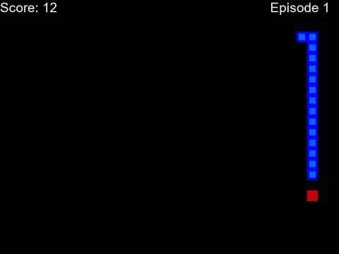

# Snake RL (DQN)

A Snake agent trained with Deep Q-Learning in PyTorch. The environment and the
network are written from scratch — no RL library.

[](media/snake-demo.mp4)

*Short loop above. The full 40-second recording is in
[`media/snake-demo.mp4`](media/snake-demo.mp4) — GitHub serves repo MP4s as a
download rather than streaming them, which is why the GIF is embedded here.*

## How it works

| Piece | Detail |
| --- | --- |
| State | 14 values: 3 danger flags, 4 current-direction flags, 4 food-position flags, 3 reachable-free-space ratios |
| Network | `Linear(14 → 512) → ReLU → Linear(512 → 3)` |
| Actions | straight, turn right, turn left (relative to the current direction) |
| Reward | `+10` for food, `-10` for crashing, `0` otherwise |
| Training | experience replay (100k memory), batch 1000, Adam at `lr=0.001`, `gamma=0.9` |
| Safety | actions that lead into a wall or the body are masked out, and a flood-fill counts reachable cells in each of the three directions |

The flood-fill feature is what keeps the agent from sealing itself in: a move is
scored by how much free space it leaves, not just by the immediate danger flag.

## Files

| File | Role |
| --- | --- |
| `game.py` | Pygame Snake environment (`play_step`, collision, food) |
| `model.py` | `Linear_QNet` and `QTrainer` |
| `agent.py` | State encoding, replay memory, action selection, training loop |
| `helper.py` | Live score plot during training |
| `record.py` | Headless recorder that pipes frames into ffmpeg |
| `model/model.pth` | Trained checkpoint used by the demo |

## Setup

```bash
python -m venv .venv
source .venv/bin/activate
pip install -r requirements.txt
```

PyTorch CPU wheels are enough; install the CUDA build yourself if you want it.

## Train

```bash
python agent.py
```

Training prints the score per episode and saves a new checkpoint whenever the
record improves. `SPEED` in `game.py` controls how fast the window updates;
lower it while watching, raise it for headless training.

## Watch / record

Play the trained model in a window:

```bash
python record.py --frames 600 --fps 20 --out media/snake-demo.mp4
```

Recording is headless: `SDL_VIDEODRIVER=dummy` is set inside the script and each
frame is streamed to `ffmpeg`, so it works over SSH. Frames that kill the snake
are held for a moment before the next episode starts.

Requires `ffmpeg` on `PATH`.
